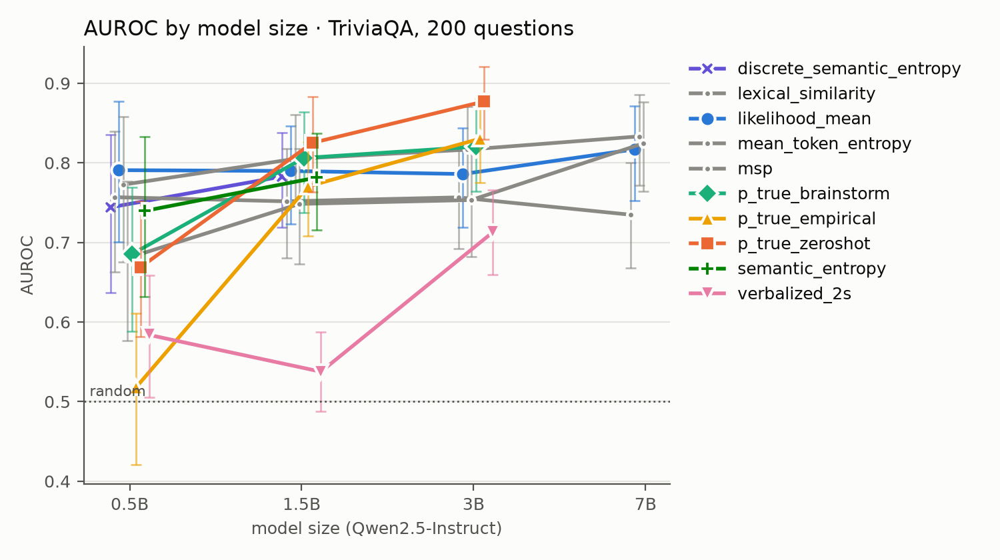

# LLM-probly experiments

Base: pwhofman/probly @ 1189b3a

## Setup
    git clone git@github.com:elifkaracaa/probly.git
    cd probly
    uv sync
    cd experiments/llm-probly

All commands below are run from `experiments/llm-probly`.

## Shared data (DATA)
    from common.data import load_data
    rows = load_data("qwen1.5b", 200)   # models: qwen0.5b, qwen1.5b, qwen3b; n: 5 or 200

One cache per model, shared by every method (cache v2). Fields per row:
`id, dataset, question, aliases` (canonical answer first), `greedy_answer, greedy_ll_sum,
greedy_ll_mean, greedy_token_logprobs, greedy_token_entropies, samples` (10),
`samples_ll_mean, samples_ll_sum, model, correct_alias, correct, samples_correct`.
Settings and library versions of each run are in `data/<model>/<dataset>_<n>.meta.json`.

Re-create a cache (TriviaQA, temperature 0.7, max 32 new tokens, stop at the first
newline, seed 42; saves after every question and resumes):

    uv run python -m scripts.generate --model qwen1.5b --n 200
    uv run python -m scripts.label    --model qwen1.5b --n 200

Details, accuracy per model and the label error rate: [docs/data_and_labelling.md](docs/data_and_labelling.md).

## Running the benchmark (PIPE)
One command runs the whole chain (generate → label → methods → evaluate → table) for one
model and dataset, skipping steps that are already done:

    uv run python -m cli run --config configs/qwen1.5b_triviaqa_200.yaml

Compare model sizes and make the plots after running each model:

    uv run python -m cli compare --dataset triviaqa --n 200
    uv run python -m cli plot --dataset triviaqa --n 200

See all methods with their family, model access and cost: `uv run python -m cli methods`.
The full report over every run (Markdown + HTML, with cost and the cheapest method tied with the best):
`uv run python -m cli report`.
A new uncertainty method is one file in `methods/` plus one entry in `common/registry.py` (see `CONTRACT.md`). Configs, metrics
(AUROC, AURC, PRR, ECE) and plots: [docs/pipeline.md](docs/pipeline.md).
Overview of all methods (family, logits, cost per question): docs/methods.md

## Results (PIPE)

TriviaQA, 200 questions, Qwen2.5 0.5B–7B. Full tables (AUROC, PRR, AURC, ECE): [`results/comparison_triviaqa_200.md`](results/comparison_triviaqa_200.md).
Rebuild with `uv run python -m scripts.compare_models` and `uv run python -m scripts.plot_results`.

| model | accuracy | precision |
|---|---|---|
| qwen0.5b | 0.190 | float32 |
| qwen1.5b | 0.375 | float32 |
| qwen3b | 0.485 | float32 |
| qwen7b | 0.590 | float16 |

AUROC (higher is better, 0.5 = random; best per model in bold):

| method | family | 0.5B | 1.5B | 3B | 7B |
|---|---|---|---|---|---|
| p_true_zeroshot | self-eval | 0.669 | **0.825** | **0.877** | – |
| p_true_brainstorm | self-eval | 0.685 | 0.806 | 0.820 | – |
| p_true_empirical | self-eval | 0.518 | 0.770 | 0.830 | – |
| verbalized_2s | self-eval | 0.584 | 0.538 | 0.713 | – |
| semantic_entropy | agreement | 0.740 | 0.781 | – | – |
| discrete_semantic_entropy | agreement | 0.744 | 0.783 | – | – |
| lexical_similarity | agreement | 0.757 | 0.752 | 0.757 | 0.735 |
| likelihood_mean | baseline | **0.791** | 0.790 | 0.786 | 0.817 |
| mean_token_entropy | baseline | 0.773 | 0.805 | 0.817 | **0.833** |
| msp | baseline | 0.680 | 0.748 | 0.753 | 0.824 |

**Takeaways**
1. Self-evaluation needs model size. Zero-shot p(True) goes 0.67 → 0.83 → 0.88 (0.5B → 1.5B → 3B) and is the best method from 1.5B on; at 0.5B every p(True) variant is worse than the cheap baselines.
2. Verbalized confidence stays weak (0.58, 0.54, 0.71); the 1.5B model answers "95" for most questions.
3. Semantic entropy and its discrete version are almost identical (0.74 / 0.78) and below zero-shot p(True) at 1.5B, although they need 10 samples and an NLI model per question.
4. The cheap baselines need no extra model calls and get better with size; at 7B mean token entropy and MSP reach 0.82–0.83.

**Notes**
- Perplexity is not listed separately: it is exp(−likelihood_mean), so it ranks the answers exactly like `likelihood_mean` (same AUROC, AURC, PRR).
- 7B ran in float16 (memory), the others in float32.
- Not run yet (–): p(True) and verbalized on 7B, SE on 3B and 7B.
- SE files were saved by hand and moved into `triviaqa_200/`; next week they will go through the runner.
- Rejection curves for 1.5B: [`results/plots/triviaqa_200_qwen1.5b_rejection.png`](results/plots/triviaqa_200_qwen1.5b_rejection.png).

## Models & cost (BIG)

All runs: TriviaQA, 200 questions, on one MacBook Air (Apple M-series, 24 GB unified memory).

| model | precision | device | memory (python process) | generation s/question | accuracy |
|---|---|---|---|---|---|
| Qwen2.5-0.5B | float32 | CPU | ~1 GB | 2.4 | 0.190 |
| Qwen2.5-1.5B | float32 | CPU | ~3 GB | 4.0 | 0.375 |
| Qwen2.5-3B | float32 | MPS | ~16 GB | 5.1 | 0.485 |
| Qwen2.5-7B | **float16** | MPS | ~17–21 GB | 9.2 | 0.590 |

Extra cost of each method, seconds per question on top of generation (`seconds_per_question` in the result files; 0.5B and 1.5B on CPU, 3B on MPS, so compare within a column):

| method | 0.5B | 1.5B | 3B |
|---|---|---|---|
| cache-only (msp, likelihood_mean, mean_token_entropy, lexical_similarity) | ~0 | ~0 | ~0 |
| p_true_zeroshot | 0.11 | 0.31 | 0.24 |
| p_true_brainstorm | 0.29 | 0.51 | 0.47 |
| verbalized_2s | 0.19 | 0.56 | 0.77 |
| p_true_empirical (10 generations) | 0.85 | 2.25 | 3.16 |
| semantic_entropy (+ NLI) | 1.61 | 0.73 | – |

**Mac limits**
- 3B in float32 fits: memory pressure stays green while generating, with a short yellow peak while the weights load.
- 7B in float32 needs ~30 GB and does not fit, so 7B runs in float16 only. Precision changes answers (0.5B: 9 of the first 50 answers changed between bfloat16 and float32), so 7B is not fully comparable with the other sizes.
- Long runs get slower on the Air (no fan): 7B took 7.3 s/question on 5 questions and 9.2 s/question on 200.
- Start long runs with `caffeinate -i` so the Mac does not sleep; `scripts.generate` saves after every question and resumes.
- Load test before a long run: `uv run python -m scripts.generate --model qwen3b --n 5 --device mps`, with Activity Monitor › Memory open.

## Tests
    uv run python -m pytest tests

## Structure
- cli.py      one entry point: run, methods, generate, label, compare, plot, check-prefix
- common/     shared code (data.py, generation.py, correctness.py: DATA; evaluate.py, io.py, summary.py, registry.py: PIPE; reflexive.py: SELF)
- scripts/    generate.py, label.py, manual_check.py (DATA); run_benchmark.py, compare_models.py, plot_results.py, check_prefix.py (PIPE); method scripts
- archive/week1/  superseded week-1 scripts, kept for reproducibility (not linted)
- methods/    one plugin per uncertainty method (see CONTRACT.md)
- configs/    one YAML file per benchmark run
- data/<model>/      <dataset>_<n>.jsonl, .meta.json, .manual_check_part
.json
- results/<model>/<dataset>_<n>/   <method>.json + summary.md (benchmark runs)
- results/<model>/   <method>.json (week 1; score contract, see CONTRACT.md)
- results/comparison_<dataset>_<n>.md, results/plots/   model comparison (PIPE)
- results/sanity/    <method>_<model>.json
- notebooks/  one notebook per person
- docs/       README sections per part
- tests/      unit tests

## Rules
- git pull at the start of the day, git push at the end
- work on a branch and open a PR into **our** main:
  github.com/elifkaracaa/probly/compare/main...BRANCH
  (the link git prints after a push targets pwhofman/probly; don't use it)
- every PR is reviewed by your second before it is merged
