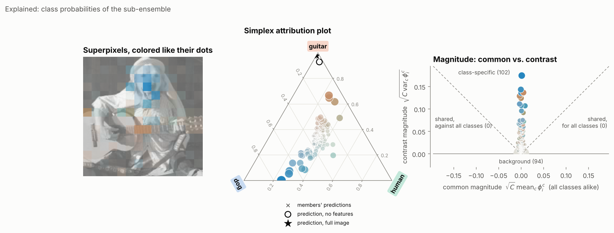
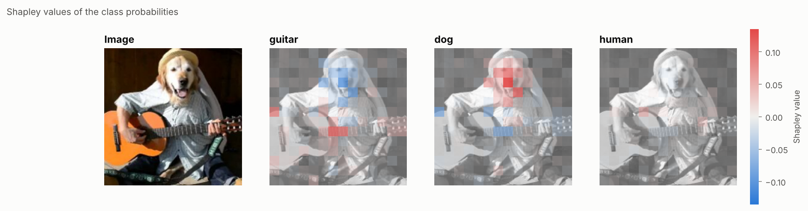
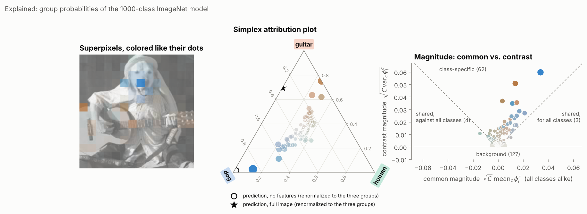

# uqxai: explaining uncertainty-aware classifiers on the probability simplex

A first experiment towards an explanation method for models whose prediction is a distribution
over classes (and, later, a distribution over such distributions). The model is a sub-ensemble
from the probly benchmark, the explanations are Shapley values computed with shapiq.

Status: the pipeline runs end to end on the dog-with-guitar image of the LIME paper. The numbers
below come from the files in `results/`.

## The idea

Explain all classes at once. A feature `i` (a superpixel) gets one Shapley value per class, a
vector `phi_i` of `C` numbers. Two questions about each feature:

- How much does it matter? Its magnitude `|phi_i|`.
- Does it matter for one class or for all alike? The variance of `phi_i` across the classes.

This gives three kinds of features:

1. background: low magnitude (and so low variance),
2. class-specific: high magnitude and high variance,
3. shared: high magnitude and low variance.

### Common and contrast part

Split a feature's attributions into the mean over the classes and the rest:

    phi_i = mean_c(phi_i) * 1  +  (phi_i - mean_c(phi_i))
            common part           contrast part

The two parts are orthogonal, so the squared magnitude splits exactly:

    |phi_i|^2 = C * mean_c(phi_i)^2  +  C * var_c(phi_i)

The variance across the classes is the squared contrast. "High magnitude, low variance" is a
feature whose magnitude is mostly common. The plane of common and contrast magnitude shows the
three regimes directly, for any number of classes: the distance to the origin is the magnitude,
background lies near the origin, class-specific features above the diagonals, shared features
below them (`uqxai.plots.regime_plane`).

### Simplex attribution plot

The contrast part sums to zero over the classes, so it is a direction in the plane of the
probability simplex. For three classes, a feature is a dot in the ternary plot at

    barycenter + scale * contrast part

with one scale for all features, the largest that keeps every dot in the triangle
(`uqxai.simplex.simplex_embedding`). Then:

- the direction of a dot says which classes the feature speaks for and against,
- its distance to the center is proportional to its standard deviation across the classes,
- its size shows its magnitude, so shared features are large dots near the center,
- the model's predictions are drawn in the same triangle: the full image, the image without any
  feature, and each ensemble member.

Rescaling all attributions jointly to `[0, 1]` and dividing each feature's by their sum
(`mode="minmax"`) gives the same picture whenever the attributions sum to zero over the classes.

### What follows for class probabilities

The class probabilities sum to one for every coalition. Shapley values are linear in the game, and
a constant game has Shapley values of zero. So for every feature

    sum_c phi_i^c = 0

when the explained outputs are the probabilities of all classes. Consequences:

- The common part is zero: with softmax probabilities, magnitude and variance carry the same
  information (`|phi_i|^2 = C * var_c(phi_i)`), and **regime 3 cannot occur**. A feature cannot
  raise the probability of all classes.
- What can occur is a feature that speaks for some classes against the others. This is a matter of
  direction, not of variance: `(2, -1, -1)` (for one class) and `(1, 1, -2)` (for two) have the
  same variance. The ternary plot shows it (a vertex versus the middle of an edge), and
  `uqxai.simplex.supported_classes` measures it for any number of classes.
- Any common part that an approximator returns is approximation error. This is a free check of the
  estimate, without ground truth.
- By efficiency, the dots add up to the step from the prediction without features to the
  prediction of the full image: `sum_i phi_i = p(full) - p(empty)`.

Regime 3 needs an output that is not a closed set of probabilities: the probabilities of a few
classes out of many, one-vs-rest scores, the evidence of a Dirichlet (evidential) model, or an
uncertainty measure. Logits have a common part, but softmax ignores it (shifting all logits
changes nothing), so there it carries no meaning.

## Results on the dog-with-guitar image

Model: the benchmark's sub-ensemble, 10 `mlp_small` heads on the frozen ImageNet ResNet-50,
trained on three groups of ImageNet-1k classes (see below). Explanation: superpixels of 16x16
pixels (196 players), absent superpixels are gray, OddSHAP with a budget of 10,000 coalitions.

The sub-ensemble predicts guitar 0.980, dog 0.020, human 0.000 for the image, and all ten heads
agree (epistemic uncertainty 0.0007 nats of 0.0995 nats in total).

- The dog's face speaks for dog and against guitar, the neck and body of the guitar for guitar and
  against dog. The dots lie on the line between the two; no superpixel speaks for human with
  any weight.
- As derived above, there are no shared features: 102 class-specific, 94 background (magnitude below
  10% of the largest). The common part holds 0.6% of the squared magnitude; it is the
  approximation error of OddSHAP, which explains each class on its own.

To see regime 3, the same coalitions are read out with the original 1000-class ImageNet
classifier, summed over the classes of each group. These three probabilities do not sum to one
(guitar 0.345, dog 0.151, human 0.001; the rest goes to other classes):

Here 20% of the squared magnitude is common and 7 features are shared. The dog's nose, the
strongest feature, is class-specific with a clear common part: it raises dog at the expense of the
other 997 classes, not of guitar.

Further figures in `results/dog_guitar_patch16_mean/`: `simplex_mean_logit.png` (the logits; less
saturated than the probabilities, same picture) and `uncertainty_maps.png` (Shapley values of total,
aleatoric and epistemic uncertainty).

### How reliable are 10,000 coalitions?

`scripts/05_reliability.py` repeats the explanation with a second, independent sample of 10,000
coalitions and correlates the two results (196 players, all classes pooled). KernelSHAP reads the
same coalitions as OddSHAP.

| readout       | approximator                  | correlation of the two samples | common part |
|---------------|-------------------------------|-------------------------------:|------------:|
| probabilities | OddSHAP                       | 0.908 | 0.6% |
| probabilities | OddSHAP, common part removed  | 0.914 | 0 |
| probabilities | KernelSHAP                    | 0.863 | 0 |
| logits        | OddSHAP                       | 0.968 | 0.9% |
| logits        | OddSHAP, common part removed  | 0.971 | 0 |
| logits        | KernelSHAP                    | 0.958 | 0.6% |

- OddSHAP is more reliable than KernelSHAP on the same coalitions, and removing the common part
  afterwards helps a little more.
- The strong features are stable, the weak ones are not yet: a correlation of 0.91 leaves visible
  noise near the center of the ternary plot. The logits are easier to approximate than the
  saturated probabilities.

### Finer superpixels

`results/dog_guitar_patch10_mean/` holds the same explanation for superpixels of 10x10 pixels (529
players, same budget): the same picture, with 153 class-specific and no shared features for the
sub-ensemble, and 11 shared features for the open-world readout.

## Caveats

- **"human" is a weak class.** ImageNet-1k has no person class. The group is the three classes
  below WordNet's `person`: ballplayer, groom and scuba diver. The sub-ensemble separates them from
  dogs and guitars almost perfectly, but it has not learned arms, hands or shirts, and gives the
  image a human probability of zero. A broader group (for example adding classes of worn
  clothing) or person images from another dataset would change this; `uqxai/classes.py` is the
  place.
- **The model is very confident and the heads agree.** On the test images the accuracy is 99.9%
  and the heads disagree on 0.03% of the predictions. Heads on frozen features of an easy problem
  give almost no epistemic uncertainty, so this model says little about question (c) below.
- **Gray is not neutral.** The image without any feature is predicted as guitar with 0.93. The
  attributions explain the step from there to the full image, in which guitar gains only 0.05.
  `--baseline blur` is implemented as an alternative (its empty image is predicted as dog).
- **Training images are 256x256 squares** of a public ImageNet mirror, resized to 224x224 as in
  the benchmark's evaluation transform. The heads use AdamW on cached features, not the LAMB recipe
  of the benchmark.

## Next steps

(a) Better approximation.
- The explained outputs share their coalitions, but OddSHAP fits each class separately. A
  multi-output surrogate (one tree ensemble with a vector leaf per class, or one shared set of
  interaction terms) would use the budget once and keep the sum over the classes at zero.
  `scripts/05_reliability.py` is the harness: split-half reliability and the size of the common
  part, recomputed from stored coalitions without the model.
- Explain `C - 1` log-ratios instead of `C` probabilities (one-vs-all versus true multi-class is
  then a choice of basis), or fit in logit space, where the games are closer to additive.
- ShaplEIG and its GP surrogate: a multi-output GP with a coregionalization kernel over the
  classes is the natural counterpart, and its posterior gives error bars for every dot.
- A reference with a large budget is still missing; with a GPU, 100k coalitions take minutes.

(b) More than three classes.
- The decomposition, the regime plane and `supported_classes` hold for any `C`.
- The ternary plot needs a choice of three: the top-3 classes with the rest merged, groups of
  classes as here, or the first two principal components of the contrast parts (they live in a
  space of `C - 1` dimensions).

(c) Second-order models.
- For an ensemble, every head has its own dot per feature; their spread is the epistemic
  uncertainty of the explanation. `--readouts member_probability` computes them.
- Uncertainty measures are games too. Total, aleatoric and epistemic uncertainty are already
  explained here (`uncertainty_maps.png`); with this model the epistemic part is empty.
- Evidential models are the natural fit: the evidence `alpha_c` per class is not a closed
  composition. The common part of its attributions is the attribution of the total evidence
  (epistemic certainty), the contrast part that of the mean prediction. All three regimes exist
  there, and regime 3 reads as "evidence without a preference for a class".
- A model with real disagreement is needed first: a deep ensemble or a sub-ensemble with a deeper
  split, or a harder problem than three well separated groups.

## Reproduce

    cd experiments/uqxai
    uv sync
    uv run python scripts/01_build_dataset.py                 # about 2.5 GB of range requests
    uv run python scripts/02_train_subensemble.py             # encodes 11k images once
    uv run python scripts/03_explain.py --patch-size 16       # 10k encoder passes
    uv run python scripts/04_plot.py dog_guitar_patch16_mean
    uv run python scripts/03_explain.py --patch-size 16 --seed 1 --readouts probability mean_logit open_world
    uv run python scripts/05_reliability.py dog_guitar_patch16_mean
    uv run pytest

The trained heads (`results/subensemble_heads.pt`) and the evaluated coalitions with the logits of
all heads (`results/*/coalitions.npz`) are in the repository, so steps 1 and 2 can be skipped, and
new readouts or approximators on the stored coalitions need no model at all. On a CPU with four
cores, the encoder handles about 27 images per second.

Data and features go to `~/datasets/uqxai` (set `UQXAI_DATA_DIR` to change this).

## Layout

- `src/uqxai/classes.py`: the three groups of ImageNet classes.
- `src/uqxai/data.py`: downloads the subset from a public parquet mirror of ImageNet-1k.
- `src/uqxai/model.py`: builds the benchmark's sub-ensemble, trains and loads the heads.
- `src/uqxai/game.py`: superpixel masking and the cache of evaluated coalitions.
- `src/uqxai/readouts.py`: the explained outputs as functions of the heads' logits.
- `src/uqxai/explain.py`: Shapley values of all outputs on shared coalitions.
- `src/uqxai/simplex.py`: common and contrast part, regimes, the simplex embedding.
- `src/uqxai/plots.py`: the figures.
- `assets/dog_guitar.jpg`: the image, taken from the `new_approximations` branch of shapiq.
