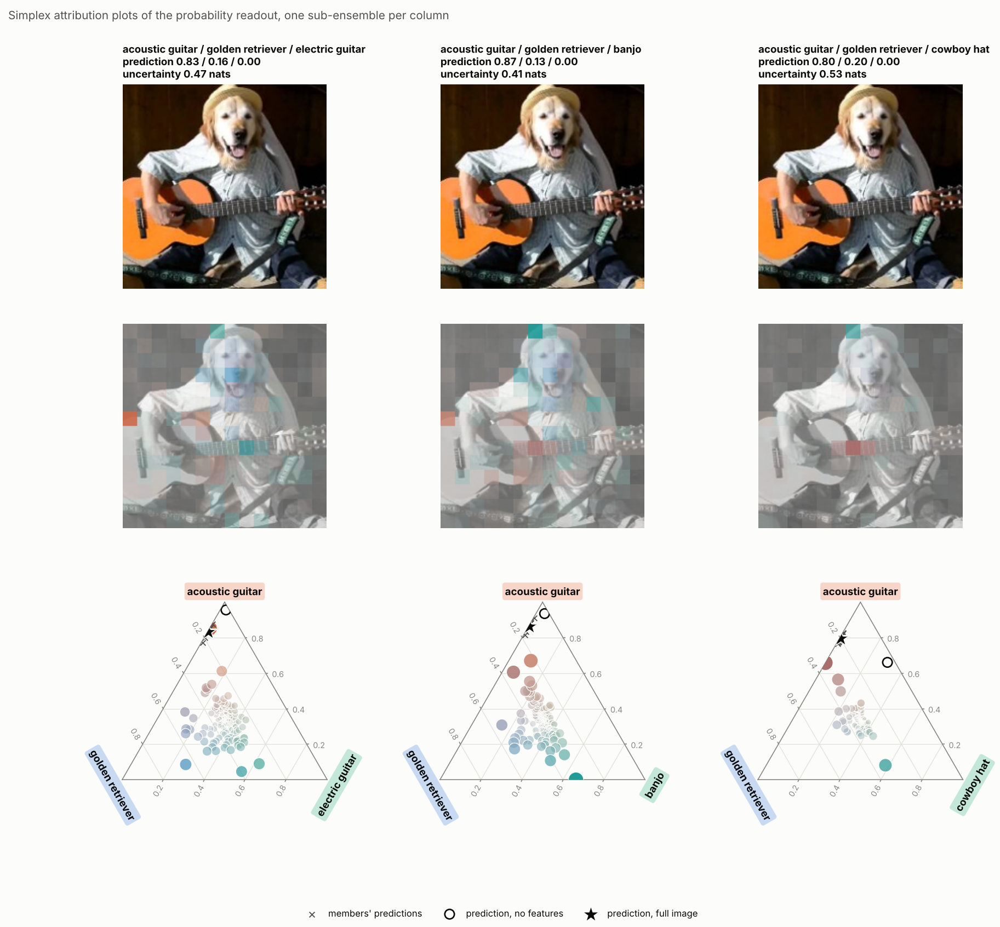
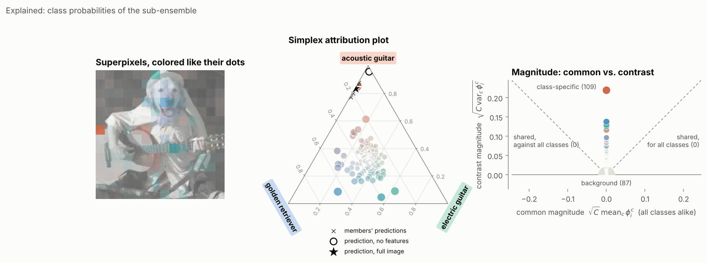
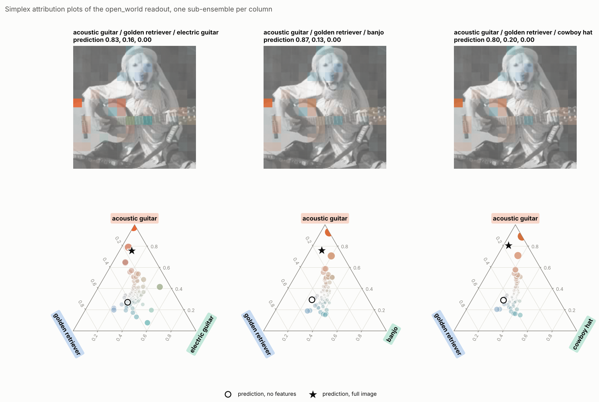
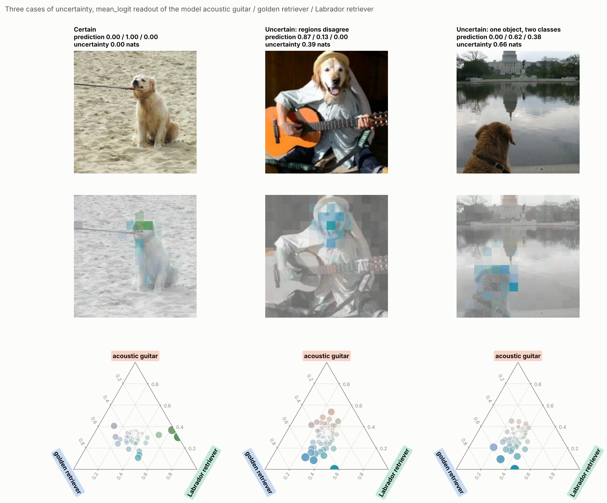
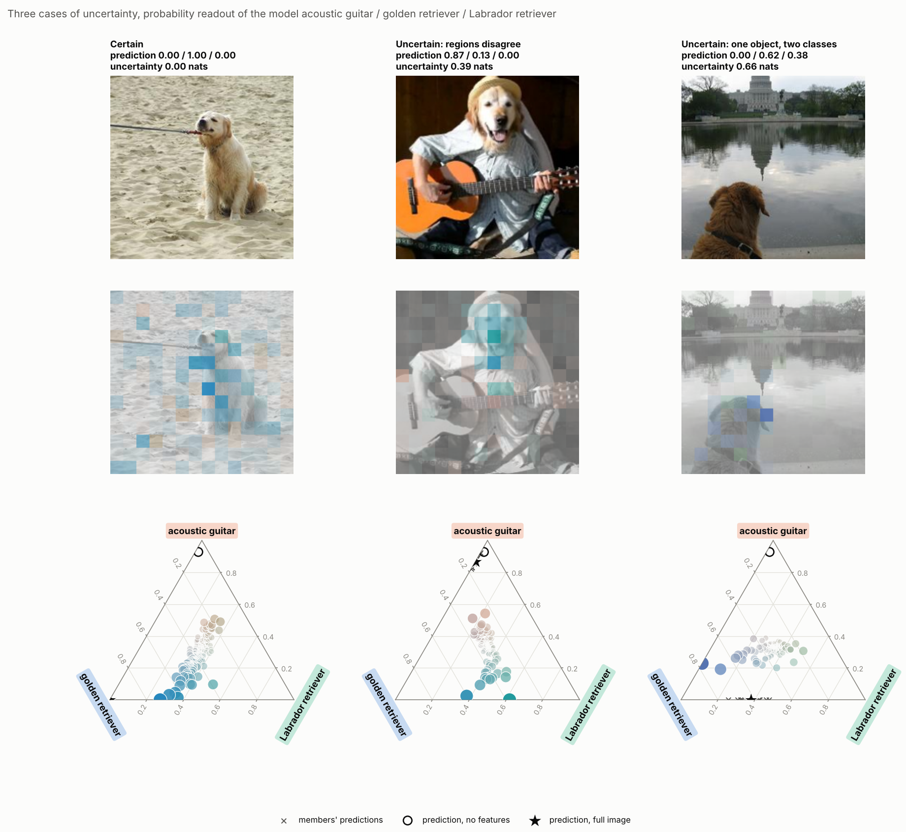
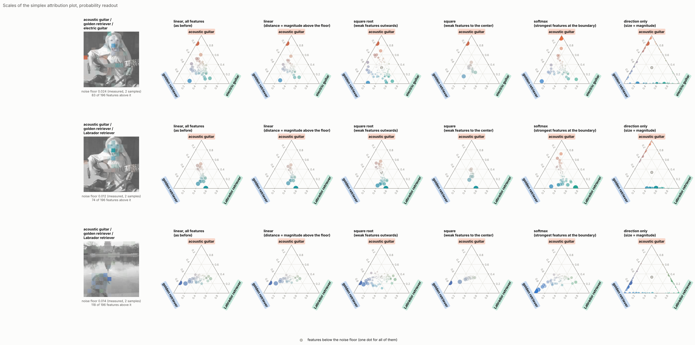

# uqxai: explaining uncertainty-aware classifiers on the probability simplex

A first experiment towards an explanation method for models whose prediction is a distribution
over classes (and, later, a distribution over such distributions). The models are sub-ensembles
from the probly benchmark, the explanations are Shapley values computed with shapiq.

Status: the pipeline runs end to end on the dog-with-guitar image of the LIME paper. The numbers
below come from the files in `results/`.

## The idea

Explain all classes at once. A feature `i` (a superpixel) gets one Shapley value per class, a
vector `phi_i` of `C` numbers. Two questions about each feature:

- How much does it matter? Its magnitude `|phi_i|`.
- Does it matter for one class or for all alike? The variance of `phi_i` across the classes.

This gives three kinds of features:

1. background: low magnitude (and so low variance),
2. class-specific: high magnitude and high variance,
3. shared: high magnitude and low variance.

### Common and contrast part

Split a feature's attributions into the mean over the classes and the rest:

    phi_i = mean_c(phi_i) * 1  +  (phi_i - mean_c(phi_i))
            common part           contrast part

The two parts are orthogonal, so the squared magnitude splits exactly:

    |phi_i|^2 = C * mean_c(phi_i)^2  +  C * var_c(phi_i)

The variance across the classes is the squared contrast. "High magnitude, low variance" is a
feature whose magnitude is mostly common. The plane of common and contrast magnitude shows the
three regimes directly, for any number of classes: the distance to the origin is the magnitude,
background lies near the origin, class-specific features above the diagonals, shared features
below them (`uqxai.plots.regime_plane`).

### Simplex attribution plot

The contrast part sums to zero over the classes, so it is a direction in the plane of the
probability simplex. For three classes, a feature is a dot in the ternary plot at

    barycenter + scale * contrast part

with one scale for all features, the largest that keeps every dot in the triangle
(`uqxai.simplex.simplex_embedding`). Then:

- the direction of a dot says which classes the feature speaks for and against,
- its distance to the center is proportional to its standard deviation across the classes,
- its size shows its magnitude, so shared features are large dots near the center,
- the model's predictions are drawn in the same triangle: the full image, the image without any
  feature, and each ensemble member.

Rescaling all attributions jointly to `[0, 1]` and dividing each feature's by their sum
(`mode="minmax"`) gives the same picture whenever the attributions sum to zero over the classes.

### What follows for class probabilities

The class probabilities sum to one for every coalition. Shapley values are linear in the game, and
a constant game has Shapley values of zero. So for every feature

    sum_c phi_i^c = 0

when the explained outputs are the probabilities of all classes. Consequences:

- The common part is zero: with softmax probabilities, magnitude and variance carry the same
  information (`|phi_i|^2 = C * var_c(phi_i)`), and **regime 3 cannot occur**. A feature cannot
  raise the probability of all classes.
- What can occur is a feature that speaks for some classes against the others. This is a matter of
  direction, not of variance: `(2, -1, -1)` (for one class) and `(1, 1, -2)` (for two) have the
  same variance. The ternary plot shows it (a vertex versus the middle of an edge), and
  `uqxai.simplex.supported_classes` measures it for any number of classes.
- Any common part that an approximator returns is approximation error. This is a free check of the
  estimate, without ground truth.
- By efficiency, the dots add up to the step from the prediction without features to the
  prediction of the full image: `sum_i phi_i = p(full) - p(empty)`.

Regime 3 needs an output that is not a closed set of probabilities: the probabilities of a few
classes out of many, one-vs-rest scores, the evidence of a Dirichlet (evidential) model, or an
uncertainty measure. Logits have a common part, but softmax ignores it (shifting all logits
changes nothing), so there it carries no meaning.

## The models

One sub-ensemble per problem: the benchmark's sub-ensemble with 10 `mlp_small` heads on the frozen
ImageNet ResNet-50, trained on three single ImageNet-1k classes (1,300 training and 50 test images
each). All problems share acoustic guitar and golden retriever, the two classes that the 1000-class
ResNet-50 ranks first for the image, and differ in the third class (`uqxai/classes.py`):

| problem    | third class     | why                                    | test accuracy |
|------------|-----------------|----------------------------------------|--------------:|
| `electric` | electric guitar | rank 3 for the image, close to class 1 | 92.0% |
| `banjo`    | banjo           | rank 4, close to class 1               | 98.7% |
| `hat`      | cowboy hat      | a third object of the image            | 98.7% |
| `labrador` | Labrador retriever | close to class 2 instead of class 1 | 96.7% |

The errors of `electric` are confusions of the two guitars (12 of 100 test images), those of
`labrador` confusions of the two dogs (5 of 100).

## Results on the dog-with-guitar image

Superpixels of 16x16 pixels (196 players), absent superpixels are gray, OddSHAP with a budget of
10,000 coalitions per model. The columns are the three models:

| problem    | prediction (guitar / retriever / third) | uncertainty | class-specific | shared | speak for two classes |
|------------|-----------------------------------------|------------:|---------------:|-------:|----------------------:|
| `electric` | 0.83 / 0.16 / 0.00                      | 0.47 nats   | 109            | 0      | 20 |
| `banjo`    | 0.87 / 0.13 / 0.00                      | 0.41 nats   | 126            | 0      | 23 |
| `hat`      | 0.80 / 0.20 / 0.00                      | 0.53 nats   | 67             | 0      | 12 |

("Speak for two classes": `supported_classes` of at least 1.5 among the class-specific features.)

- **All three corners are in use.** The models agree on the prediction (acoustic guitar, with 0.13
  to 0.20 for the retriever), but the superpixels now point in three directions.
- **The dog and the guitar are stable.** The dog's nose speaks for golden retriever in every
  model (+1.4 on its logit in all three), the edge of the guitar's body for acoustic guitar.
- **The third class decides what the rest means.** The top of the hat speaks against acoustic
  guitar in all models (-0.08, -0.12, -0.13), and the gain goes to whichever third class is on
  offer: electric guitar (+0.10), banjo (+0.12) or cowboy hat (+0.14). Only the last reading is
  about a hat. A piece of the guitar's neck speaks for acoustic guitar against banjo (+0.10, -0.10)
  and against cowboy hat (+0.17, -0.18), but two superpixels further along the neck speak for
  electric guitar against acoustic guitar (+0.07, -0.10).
- **No shared features, as derived above.** The common part holds 0.8% to 0.9% of the squared
  magnitude in each model; it is the approximation error of OddSHAP, which explains each class on
  its own. The figures of the sub-ensemble's probabilities show the attributions without it.
- **Features for two classes exist**, 12 to 23 per model. They are the form in which a softmax
  model can show "speaks for more than one class".

Per model, `results/<problem>/dog_guitar_patch16_mean/` holds `simplex_probability.png` (with the
plane of common and contrast magnitude), `simplex_mean_logit.png`, `class_maps.png` and
`uncertainty_maps.png`:

### Regime 3 in the open world

The same coalitions, read out with the original 1000-class ImageNet classifier for the three
classes of each problem. These probabilities do not sum to one (acoustic guitar 0.31, golden
retriever 0.06, electric guitar 0.04, banjo 0.04, cowboy hat 0.01):

Here 23% to 28% of the squared magnitude is common, and 9, 5 and 2 features are shared. In
`electric`, the guitar's neck raises both guitars (acoustic +0.015, electric +0.020) at the expense
of classes outside the triple: the wheel that speaks for car and truck.

### Uncertainty

The uncertainty of the three models for the image is almost entirely aleatoric: the heads agree
(epistemic part at most 0.003 nats). Its Shapley values (`uncertainty_maps.png`) show the dog's face
raising the uncertainty (+0.05 to +0.09 nats for the nose) and the guitar's body lowering it (down
to -0.10): the face argues against the predicted class.

## Three cases of uncertainty

Two models with a pair of similar classes (`electric`: two guitars, `labrador`: two dogs), three
test images each, chosen from the predictions alone by `scripts/07_select_cases.py`:

- **certain**: a clear golden retriever from the validation images (uncertainty 0.00 nats).
- **uncertain, regions disagree**: the dog-with-guitar image (0.47 and 0.39 nats).
- **uncertain, one object fits two classes**: the validation image with the most even split
  between the two similar classes (0.66 nats in both models): a guitar for `electric` (acoustic
  0.64, electric 0.36), a dog seen from behind for `labrador` (golden 0.62, Labrador 0.38).

One image per case, so the following are observations, not statistics.

(`results/cases_electric_*.png` for the other model, `results/cases.json` for the numbers.)

**One feature for two classes.** It appears as soon as the model has two similar classes, also in
images that are not ambiguous:

- The dog's nose in the dog-with-guitar image is the feature for golden retriever in `electric`
  (guitar -0.08, golden +0.11, electric -0.02). In `labrador` the same superpixel speaks for both
  dogs against the guitar, on the logits by (-1.1, +0.4, +0.9): more for Labrador than for golden.
- In the dog seen from behind, two of the four strongest features speak for both dogs alike, e.g.
  (-1.0, +0.7, +0.5) on the logits. Summed over all superpixels, the image moves the logits by
  -9.2 for guitar, +4.0 for golden and +4.7 for Labrador.
- With three classes, "for two classes" and "against one class" are the same statement. The
  ambiguous guitar speaks for electric guitar and, weakly, for golden retriever, e.g. (-0.5, +0.1,
  +0.4): it speaks against acoustic guitar, which is what the model predicts for a gray image.

**Logits and probabilities answer different questions.** On the logits, the dog's fur is evidence
for both dogs. On the probabilities, the same superpixels separate the dogs, e.g. (-0.04, +0.18,
-0.14): any piece of the dog rules out the guitar, so the probabilities only show what decides
between the classes that are left. The triangle of the probabilities shows this as a band between
the two dog corners.

**The certain image has no important feature.** Its largest attribution is below 0.05, against 0.08 to
0.18 for the uncertain images, and the attributions are spread over about 110 of the 196
superpixels: many pieces of the dog are each enough. The game saturates, and the approximation
error is the largest here (common part 5% to 6% of the squared magnitude, removed in the figures).

**What did not work.** I expected the kind of uncertainty to show in one number: the share of the
attribution magnitude that comes from features for two classes. It does not separate the cases:

| model      | certain | regions disagree | one object, two classes |
|------------|--------:|-----------------:|------------------------:|
| `electric`, probabilities | 0.20 | 0.18 | 0.00 |
| `electric`, logits        | 0.26 | 0.14 | 0.26 |
| `labrador`, probabilities | 0.17 | 0.34 | 0.12 |
| `labrador`, logits        | 0.30 | 0.29 | 0.27 |

Features for two classes follow from which classes the model has, more than from how uncertain it
is about the image. What does differ is where the magnitude goes: to one class for the certain
image (71% to 76% favor golden retriever), to all three for the dog-with-guitar image, and to the
two similar classes for the third case (`electric`: 46% and 54%; `labrador`: 58% and 39%).

## Noise and the scale of the triangle

The weak features form a cloud around the center of the triangle. How much of it is noise can be
measured with a second, independent coalition sample (`03_explain.py --seed 1`): the difference of
the two estimates gives the standard deviation of the noise, which is about the same for weak and
strong features, and from it the magnitude that 99% of pure-noise features stay below
(`uqxai.simplex.noise_floor`). For the mean of two samples of 10,000 coalitions:

| explanation                     | readout       | noise floor     | features above it |
|---------------------------------|---------------|-----------------|------------------:|
| `electric`, dog with guitar     | probabilities | 11% of the largest magnitude | 83 of 196 |
| `electric`, dog with guitar     | logits        | 7%              | 117 |
| `labrador`, dog with guitar     | probabilities | 11%             | 74 |
| `labrador`, dog with guitar     | logits        | 6%              | 132 |
| `labrador`, dog seen from behind | probabilities | 6%             | 118 |
| `labrador`, dog seen from behind | logits        | 6%             | 115 |

So between a third and two thirds of the features are below the floor. The rest of the cloud are
weak effects that the noise does not explain. Without a second
sample, `uqxai.simplex.robust_noise_floor` gives a bound from the median magnitude; it came out two
to three times too high here.

`scripts/08_scaling_gallery.py` draws the same explanations with different scales
(`results/scaling_gallery_probability.png`, `results/scaling_gallery_mean_logit.png`). All but the
first hide the features below the noise floor behind one gray dot and measure the distance to the
center from the floor:

- **linear**: the distance is the magnitude above the floor; the only scale on which distances can
  be compared as numbers.
- **square root**: spreads the weak features outwards, to see where they point.
- **square**: pulls the weak features to the center, so that only the strong ones stand out.
- **softmax**: the softmax of the scaled contrast. The strongest features lie near the boundary in
  every direction; on the linear scale a feature against one class reaches the boundary at half
  the distance of a feature for one class.
- **direction only**: every feature on the boundary, its size is its magnitude.

The scales are options of `uqxai.simplex.simplex_embedding` (`scale`, `noise_floor`, `exponent`,
`sharpness`), which `ternary_plot` and `simplex_map` take as `embedding`. The other figures in this
README still use the linear scale with all features.

## Earlier run: groups of classes

The first version of this experiment used one model for three groups of ImageNet classes: guitar
(2 classes), dog (118 breeds) and human (ballplayer, groom, scuba diver). Its results are kept in
`results/archive_guitar_dog_human/`; the scripts no longer build it (see commit `087df16`). It
predicted guitar 0.98, dog 0.02, human 0.00, with every superpixel on the line between guitar and
dog. Two checks were made with it and not yet repeated for the models above.

### How reliable are 10,000 coalitions?

`scripts/05_reliability.py` repeats the explanation with a second, independent sample of 10,000
coalitions and correlates the two results (196 players, all classes pooled). KernelSHAP reads the
same coalitions as OddSHAP. (Group model.)

| readout       | approximator                  | correlation of the two samples | common part |
|---------------|-------------------------------|-------------------------------:|------------:|
| probabilities | OddSHAP                       | 0.908 | 0.6% |
| probabilities | OddSHAP, common part removed  | 0.914 | 0 |
| probabilities | KernelSHAP                    | 0.863 | 0 |
| logits        | OddSHAP                       | 0.968 | 0.9% |
| logits        | OddSHAP, common part removed  | 0.971 | 0 |
| logits        | KernelSHAP                    | 0.958 | 0.6% |

- OddSHAP is more reliable than KernelSHAP on the same coalitions, and removing the common part
  afterwards helps a little more.
- The strong features are stable, the weak ones are not yet: a correlation of 0.91 leaves visible
  noise near the center of the ternary plot. The logits are easier to approximate than the
  saturated probabilities.

### Finer superpixels

| superpixel | players | coalitions | class-specific | shared | common part (error) |
|------------|--------:|-----------:|---------------:|-------:|--------------------:|
| 16x16 px   |     196 |     10,000 |            102 |      0 | 0.6% |
| 10x10 px   |     529 |     10,000 |            153 |      0 | 1.1% |
| 6x6 px     |   1,444 |     20,000 |            648 |      0 | 2.1% |

(Group model, sub-ensemble probabilities; the figures are in
`results/archive_guitar_dog_human/`.)

- At 10x10 pixels the picture is the same as at 16x16.
- At 6x6 pixels the dog's nose still stands out, but the rest is mostly noise: the error grows, and
  the 648 "class-specific" superpixels are an artifact of the background threshold (10% of the
  largest magnitude), which then lies below the noise. The threshold should come from the error,
  for example from the common part or from two seeds.
- 4x4 pixels (3,136 players) were not run. OddSHAP considers at most `budget / 10` terms, so it
  needs more than 31,000 coalitions to give every superpixel a value at all, and far more for a
  stable picture. That is a job for a GPU, and a reason for question (a).

## Caveats

- **The heads agree.** Heads on frozen features give almost no epistemic uncertainty, also for the
  harder `electric` problem (the heads disagree on 0.4% of the test predictions). These models say
  little about question (c) below.
- **Gray is not neutral.** The image without any feature is predicted as acoustic guitar with 0.96
  (`electric`), 0.94 (`banjo`), 0.93 (`labrador`) and 0.66 (`hat`, with 0.30 for cowboy hat). The attributions explain
  the step from there to the full image. `--baseline blur` is implemented as an alternative.
- **The explanation is relative to the alternatives.** A superpixel speaks for a class against the
  other two. The top of the hat "is" an electric guitar, a banjo or a hat, depending on the model.
- **Small test sets:** 50 images per class.
- **Training images are 256x256 squares** of a public ImageNet mirror, resized to 224x224 as in
  the benchmark's evaluation transform. The heads use AdamW on cached features, not the LAMB recipe
  of the benchmark.

## Next steps

(a) Better approximation.
- The explained outputs share their coalitions, but OddSHAP fits each class separately. A
  multi-output surrogate (one tree ensemble with a vector leaf per class, or one shared set of
  interaction terms) would use the budget once and keep the sum over the classes at zero.
  `scripts/05_reliability.py` is the harness: split-half reliability and the size of the common
  part, recomputed from stored coalitions without the model.
- Explain `C - 1` log-ratios instead of `C` probabilities (one-vs-all versus true multi-class is
  then a choice of basis), or fit in logit space, where the games are closer to additive.
- ShaplEIG and its GP surrogate: a multi-output GP with a coregionalization kernel over the
  classes is the natural counterpart, and its posterior gives error bars for every dot.
- A reference with a large budget is still missing; with a GPU, 100k coalitions take minutes.

(b) More than three classes.
- The decomposition, the regime plane and `supported_classes` hold for any `C`.
- The ternary plot needs a choice of three: the top-3 classes with the rest merged, groups of
  classes as here, or the first two principal components of the contrast parts (they live in a
  space of `C - 1` dimensions).

(c) Second-order models.
- For an ensemble, every head has its own dot per feature; their spread is the epistemic
  uncertainty of the explanation. `--readouts member_probability` computes them.
- Uncertainty measures are games too. Total, aleatoric and epistemic uncertainty are already
  explained here (`uncertainty_maps.png`); with this model the epistemic part is empty.
- Evidential models are the natural fit: the evidence `alpha_c` per class is not a closed
  composition. The common part of its attributions is the attribution of the total evidence
  (epistemic certainty), the contrast part that of the mean prediction. All three regimes exist
  there, and regime 3 reads as "evidence without a preference for a class".
- A model with real disagreement is needed first: a deep ensemble or a sub-ensemble with a deeper
  split. A harder problem alone (`electric`) does not make the heads disagree.

## Reproduce

    cd experiments/uqxai
    uv sync
    uv run python scripts/01_build_dataset.py        # six ImageNet classes, about 1 GB of range requests
    uv run python scripts/02_train_subensemble.py    # encodes 8,100 images once, trains all problems
    uv run python scripts/03_explain.py              # 10k encoder passes per problem
    uv run python scripts/04_plot.py electric/dog_guitar_patch16_mean
    uv run python scripts/06_compare.py
    uv run python scripts/07_select_cases.py         # writes assets/cases and assets/cases.json
    uv run python scripts/03_explain.py --cases      # five more explanations
    uv run python scripts/06_compare.py --cases
    uv run python scripts/08_scaling_gallery.py      # needs --seed 1 runs for measured noise floors
    uv run pytest

Steps 1 to 3 and 6 take `--problems electric banjo hat labrador` to choose; a new problem is one line in
`uqxai/classes.py`. For the reliability check, run step 3 again with `--seed 1` and then
`scripts/05_reliability.py electric/dog_guitar_patch16_mean`.

The trained heads (`results/<problem>/subensemble_heads.pt`) and the evaluated coalitions with the
logits of all heads (`results/<problem>/*/coalitions.npz`) are in the repository, so steps 1 and 2
can be skipped, and new readouts or approximators on the stored coalitions need no model at all. On
a CPU with four cores, the encoder handles about 27 images per second.

Data and features go to `~/datasets/uqxai` (set `UQXAI_DATA_DIR` to change this).

## Layout

- `src/uqxai/classes.py`: the problems, each a triple of ImageNet classes.
- `src/uqxai/data.py`: downloads single classes from a public parquet mirror of ImageNet-1k.
- `src/uqxai/model.py`: builds the benchmark's sub-ensemble, trains and loads the heads.
- `src/uqxai/game.py`: superpixel masking and the cache of evaluated coalitions.
- `src/uqxai/readouts.py`: the explained outputs as functions of the heads' logits.
- `src/uqxai/explain.py`: Shapley values of all outputs on shared coalitions.
- `src/uqxai/simplex.py`: common and contrast part, regimes, the simplex embedding.
- `src/uqxai/results.py`: reads stored explanations, pooling coalition samples.
- `src/uqxai/plots.py`: the figures.
- `assets/dog_guitar.jpg`: the image, taken from the `new_approximations` branch of shapiq.
- `assets/cases/`: three ImageNet validation images, selected by `scripts/07_select_cases.py`.
